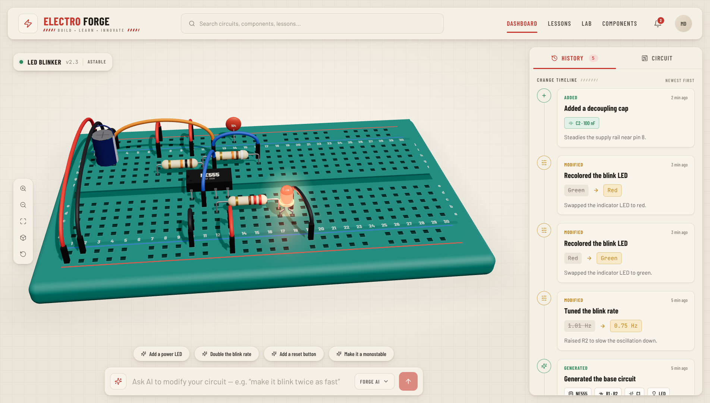

# Electro Forge 3D

An AI circuit workbench: describe a change in plain English and watch it happen on a 3D breadboard.



## Run it

```bash
npm install
npm run dev      # http://localhost:5173
npm run build    # type-check + production build
```

## Stack

- React 18 + TypeScript, built with Vite
- Three.js through `@react-three/fiber` and `@react-three/drei`. Every part is modelled in code, so there are no image assets.
- Tailwind CSS for the UI, `zustand` for state, `lucide-react` icons

## Layout

```
src/
  circuit/     data model: board geometry, parts, values, starting circuit and history
  store/       app state (circuit, history, panel tab, camera commands)
  scene/       3D: breadboard, camera rig, one component per part type
  components/  UI: header, project badge, view toolbar, prompt bar, side panel
```

## Roadmap

1. **App shell + 3D board** (done)
2. **Command engine + pick-and-place animations** (done): move, flip, swap, recolor, blink rate, remove
3. **Suggestion chips, buttons, netlist, undo** (done): power LED, reset button, monostable mode, clickable 3D buttons, Circuit tab with parts and netlist, search, notifications, Ctrl/Cmd+Z
4. **Forge AI picker** (done): built-in parser or a local LLM through Ollama
5. Lessons, Lab and Components pages

## Things you can type

| Say | What happens |
|---|---|
| `flip the capacitor` | C1 lifts, turns 180° and drops back in reversed |
| `move resistor at c12 to a3` / `move R3 to a20` | the part lifts, travels across the board and lands in the new holes |
| `swap R3 with a 100k` / `change R1 to 22k` / `swap C1 with 22uF` | the old part rises out and the new value drops in |
| `change led color to green` | the LED is swapped for a green one |
| `make it blink twice as fast` / `blink at 2 Hz` / `slower` | R2 (or C1) is retuned using f = 1.44 / ((R1 + 2·R2)·C1) |
| `remove C2` | the part is pulled off the board |
| `add a power LED` | a green LED and 1 kΩ resistor drop in across the rails |
| `add a reset button` | SW1 plus a pull-up replace the hard RESET tie. Hold the button in 3D to stop the timer |
| `make it a monostable` / `make it astable` | cuts or restores the THR–TRIG link. In monostable mode, click the yellow trigger button for one pulse |
| `undo` (or Ctrl/Cmd+Z) | rolls back the last change |

Each change adds a card to the History timeline.

## Using a local model (optional)

The **Forge AI ▾** picker next to the send button switches between:

- **Forge AI · built-in**: instant and offline. It understands the phrases listed above.
- **Local model · Ollama**: write requests in your own words, e.g. *"the LED resistor is in the way, shift it right and make the light blue"*. The model turns the request into commands from the table above, and each one runs with its own animation and History card.

```bash
ollama pull llama3.2    # or any chat model
ollama serve            # listens on localhost:11434
```

In `npm run dev` the app reaches Ollama through the dev server at `/ollama`, so no CORS setup is needed. For a production build, set the URL to `http://localhost:11434` in the picker and start Ollama with `OLLAMA_ORIGINS=*`. Click **Test** to list your installed models. If the model can't be reached, the prompt falls back to the built-in parser. Your choice is saved in the browser.
